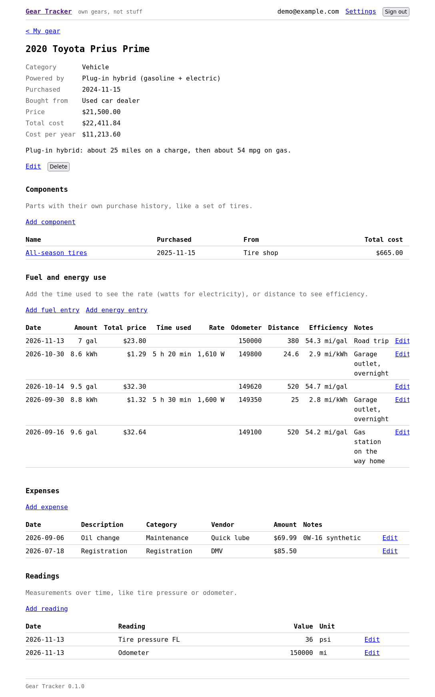
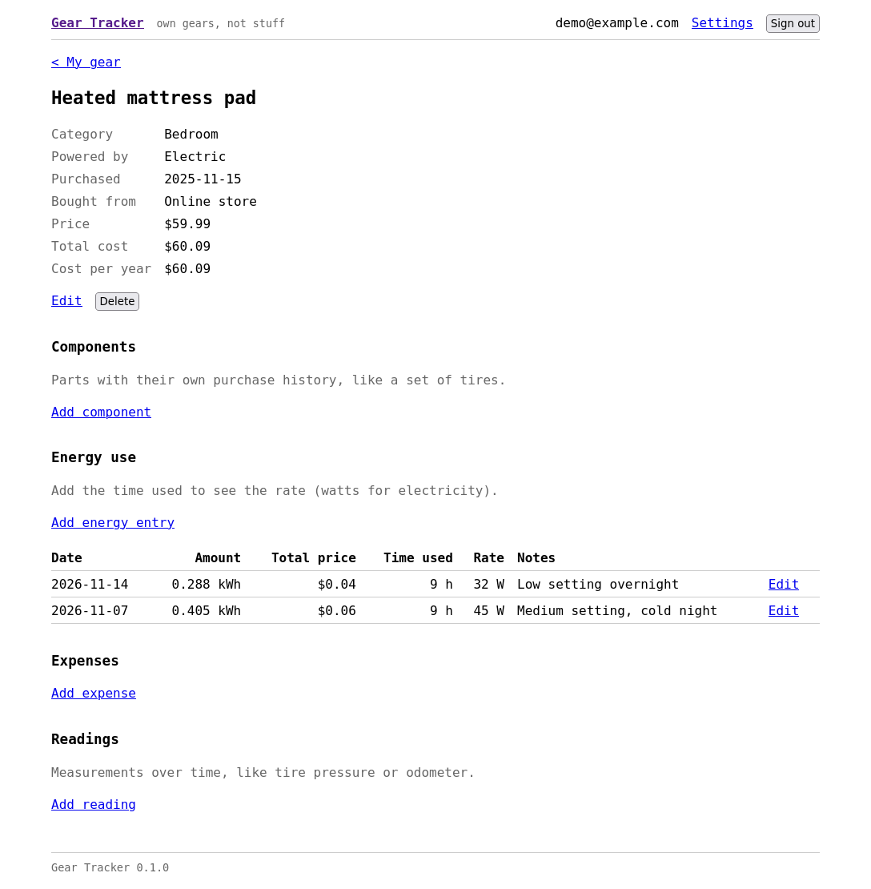
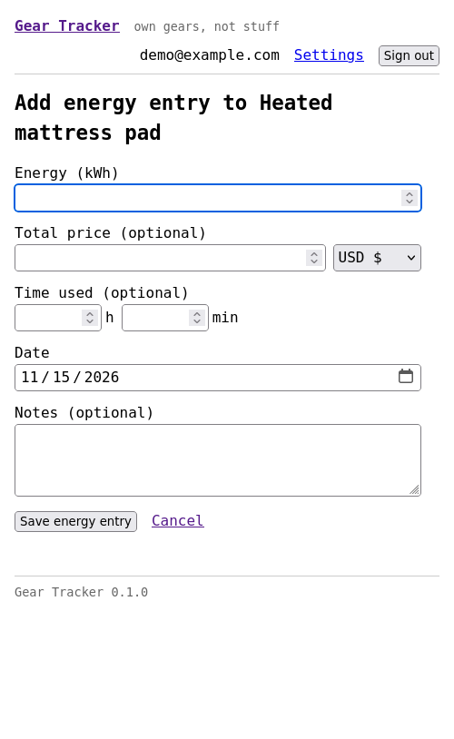

# Gear Tracker

Own gears, not stuff. A text-based web app for recording what you own, when you
bought it, where from, and what it has really cost you. Each user sees only
their own gear, and what others choose to make public.

- **Gear**: anything you own, with its purchase date, price, and where you bought it.
  Vehicles can also note their year, make, model and trim, and a nickname.
- **Components**: gear that belongs to other gear, like a set of tires on a car.
  Their costs count toward the parent's total.
- **Expenses**: money spent after the purchase, like repairs or insurance. Expenses of
  vehicles and their parts can note the odometer.
- **Power source**: what makes the gear go: nothing, human power, gasoline, diesel,
  propane, electricity, or both gasoline and electricity for a plug-in hybrid.
- **Fuel entries**: fill-ups (gallons) or energy use (kWh) for gear that runs on fuel or
  electricity. Add the time used to see fuel per hour or average watts, or the
  odometer or miles driven to see miles per gallon or per kWh, from one full tank to
  the next.
- **Vehicle stats**: running costs in total, per year, per mile or km and by category, and
  average, best, worst and latest efficiency.
- **Readings**: measurements over time, like tire pressure or tread depth. Readings of
  vehicles and their parts can also note the odometer.
- **API for agents**: let an agent or script read your gear and log expenses, fuel and
  energy use, and readings, with a token you create in Settings. See
  [docs/api.md](docs/api.md), also served at `/api/v1`, which also shows how to log
  fuel from an iPhone Shortcut.
- **Settings**: your currency, miles or kilometers, and US gallons, UK gallons or
  liters. Fuel entries are stored in kilometers and liters and shown in your units, so
  changing units updates old entries too. Your currency is the default for new prices and
  expenses; each one can be set to its own currency on its form. Totals in more than
  one currency show each separately.
- **Public profile**: optional. Pick a display name and username, turn your profile on,
  and choose which gear to show at `/u/<username>`, with or without its costs.
- **Vehicles page**: optional. List a vehicle at `/vehicles` to help people choosing a car,
  with or without its price, running costs and efficiency, and without your name unless
  you choose to show it.
- **Your data**: download everything as a JSON file, import that file into a new
  account, or delete your account, all from Settings.

## Screenshots

From version 0.1.0, with the demo's sample gear.

**Your gear**, with what each has really cost, in total and per year:

**A plug-in hybrid** (2020 Toyota Prius Prime at 150,000 miles) logging both gas
fill-ups and charging, with miles per gallon and miles per kWh:

**An appliance's energy use**: a heated mattress pad that averaged 32 W over a
9-hour night:

**On a phone**, adding an energy entry with time used in hours and minutes:

## Try the demo

The button starts Gear Tracker in your own GitHub Codespace, free with a GitHub
account. After a minute or two the app opens in a new tab with sample gear:

- a **2020 Toyota Prius Prime** plug-in hybrid at 150,000 miles, with gas fill-ups
  (about 54 mpg) and charging sessions
- a **heated mattress pad** that averaged 32 W over a 9-hour night
- a bicycle, a rain jacket, and the Prius's tires as a component

Sign in as `demo@example.com` with password `demo-password` (the sign-in page fills
them in). Add, change and delete anything: the demo resets every time the Codespace
starts, and your changes never leave your Codespace. Delete the Codespace from
[github.com/codespaces](https://github.com/codespaces) when you're done.

A Codespace keeps the version it was created with; the page footer shows which one.
To try a newer version, delete the old Codespace and create a new one.

To run the demo on your own computer, use a separate database so your own data isn't
wiped:

    export GEAR_TRACKER_DEMO=1 DATABASE_URL=sqlite3:storage/demo.sqlite3
    bin/rails demo:reset
    bin/rails server

`demo:reset` wipes the database it's pointed at, so it refuses to run without
`GEAR_TRACKER_DEMO=1`, and never runs in production. The demo data is in `lib/demo.rb`.

## Running it

Requires Ruby 3.4.2.

    bundle install
    bin/rails db:prepare
    bin/rails server

Then open http://localhost:3000 and sign up.

## Tests

    bin/rails test          # the test suite
    bin/rails test:system   # the few tests that need a browser; needs Firefox
    bin/ci                  # everything a pull request must pass: security scans, both kinds of tests and seeds

## Keeping your data

The database is one file, `storage/development.sqlite3`. It isn't stored in git.

`bin/rails db:migrate` and `db:rollback` save a copy to `storage/backups` before
changing anything. To make or restore a copy yourself:

    bin/rails db:backup
    bin/rails db:restore FILE=storage/backups/name.sqlite3

Stop the server before restoring. Restoring saves a copy of the current database
first. Backups live on the same disk, so copy them elsewhere too.

## Hosting

[docs/hosting.md](docs/hosting.md) walks through putting Gear Tracker online on a
small server with Kamal, for about $60–80 a year: the domain, locking the server
down, HTTPS, email, off-site backups, the first deploy, a backup-restore drill,
and upkeep.

## Contributing

Bug reports, ideas and pull requests are welcome. For anything bigger than a small
fix, open an issue first so we can agree on the approach before you write code.

### How to send a change

1. Fork the repository and branch from `main`. Keep one topic per pull request.
2. Write a failing test, make it pass, then tidy the code (red, green, refactor).
3. Run `bin/ci` and make sure it passes.
4. Open a pull request that says what changed, why, and how you tested it. Add a
   screenshot for changes to pages.

### Every pull request must

**Be tested**

- **Test first.** New behavior comes with tests written before the code: model tests
  for rules and calculations, controller tests for pages, requests and access.
- **Give every bug its own test.** Reproduce the bug in a failing test, then fix it.
  The test stays, so the same bug can't come back unnoticed.
- **Keep the whole suite green.** `bin/ci` passes. Don't skip, weaken or delete a
  failing test to get there.
- **Test the edges,** not just the happy path: blank and invalid input, another
  user's records, and old data.

**Keep the code easy to change**

- **Don't repeat yourself.** Every piece of knowledge lives in one place: a label, a
  unit, a currency, a conversion factor. For example, units are defined only in
  `app/models/units.rb`, currencies only in `User::CURRENCIES`, and the money input
  only in `app/views/shared/_money_field.html.erb`.
- **Keep it simple.** Build what's needed now, not options someone might want later.
- **Keep parts independent.** Models own rules and data, controllers handle requests,
  views display. A change in one shouldn't ripple through the others.
- **Fail early and loudly.** Validate data in models, and don't silently swallow
  errors.
- **Fix broken windows.** If you notice a small problem in code you touch, fix it or
  open an issue. Keep unrelated cleanups out of the pull request.
- **Follow Rails conventions** and the style of the code around you. Prefer plain
  Rails over a new gem, and explain in the pull request why any new dependency is
  needed.
- **Name things for what they are.** Comments explain why, not what.

**Protect people's data**

- **Never lose data in a migration.** Convert existing records instead of dropping
  them, and make sure `bin/rails db:rollback` works. `bin/rails db:migrate` backs up
  the database first.
- **Store one canonical form.** Distance and volume are stored in metric and converted
  for display. Money keeps the currency it was entered in, and amounts in different
  currencies are never added together.

**Be secure**

- **Scope every query to the signed-in user,** as in `Current.user.gears.find(id)`,
  never `Gear.find(id)`. Add a test that another user's records return "not found".
- **Permit only what the user may change.** Use `params.expect` with a list of
  fields, and never permit ownership fields like `user_id`.
- **Treat all input as untrusted.** Validate it in models. Build queries with Active
  Record methods or bound parameters, never by putting input into SQL strings.
- **Let Rails escape output.** Don't use `html_safe` or `raw` on anything a user typed.
- **No inline JavaScript or styles,** and nothing loaded from other sites. The Content
  Security Policy in `config/initializers/content_security_policy.rb` blocks them. Put
  code in `app/javascript` and styles in `app/assets/stylesheets`.
- **Keep Rails' protections on:** CSRF tokens, HTTPS in production, and the rate
  limits on sign-in, sign-up and password reset.
- **Keep secrets out of git.** Use Rails credentials or environment variables, and
  don't log passwords, tokens or personal data.
- **Test authentication changes,** including wrong passwords, expired tokens and rate
  limits.
- **Keep the API locked to its token.** Every API endpoint signs in only with a token
  in the `Authorization` header, finds records through `current_user`, and checks
  write access before changing anything. Each new endpoint needs tests for: no token,
  a revoked token, a read-only token, and another user's records. See
  `test/controllers/api/v1/security_test.rb`.
- **Document every API change** in `docs/api.md`, which the app also serves to agents.
  A field that's added, renamed or removed must change there in the same pull request.
- **Pass the security scans.** `bin/ci` runs Brakeman, which checks the code for
  common Rails security mistakes, and audits the gems and JavaScript packages for
  known vulnerabilities. Fix what they find; if a warning is truly a false alarm,
  record why in the pull request.
- **Use made-up data** in fixtures, screenshots and issues, never real people's.

### Releasing a version

Versions follow [Semantic Versioning](https://semver.org/) and are listed in
[CHANGELOG.md](CHANGELOG.md). To release one:

1. Pick the number: patch (0.1.**1**) for fixes, minor (0.**2**.0) for new features,
   major (**1**.0.0) for changes that break something users or API clients rely on.
2. Change `VERSION`, and add a dated section for it at the top of `CHANGELOG.md`
   (a test fails if you forget).
3. Commit, then tag the commit: `git tag -a v0.2.0 -m "Version 0.2.0"`, and push
   with `git push --follow-tags`.

Pull requests don't change the version; it's set when a release is made.

### Reporting a bug

Open an issue with the steps to reproduce it, what you expected, what happened
instead, and your browser.

### Reporting a security problem

Don't open a public issue. Use **Report a vulnerability** on the repository's
**Security** tab, so it can be fixed before it's made public. Include the steps to
reproduce it.

These guidelines follow *The Pragmatic Programmer* by David Thomas and Andrew Hunt,
the [Rails security guide](https://guides.rubyonrails.org/security.html), and the
[OWASP Top 10](https://owasp.org/www-project-top-ten/).
