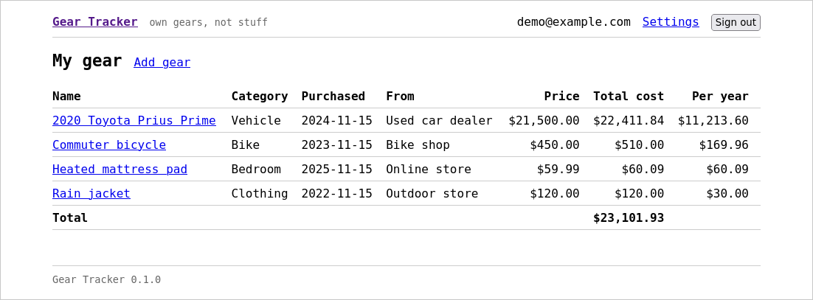

# Gear Tracker

Own gears, not stuff. A text-based web app for recording what you own, when you
bought it, where it came from, and what it has really cost you.\
Each user can see the gears they own and the gears made public by other users.

## Using it

- [Features](docs/features.md): what you can track, and the costs and efficiency it calculates
- [Log fuel from an iPhone Shortcut](docs/iphone-shortcut.md): a few taps, no agent needed
- [API for agents and scripts](docs/api.md): read your gear and log records with a token

## Running it

- [Try the demo](docs/demo.md): in a Codespace or on your computer
- [Run it on your computer](docs/development.md): setup, tests and backups
- [Host it](docs/hosting.md): online on a small server, for about $60–80 a year

## Contributing

- [Contributing](CONTRIBUTING.md): how to send a change, what every pull request
  must do, releasing a version, and reporting bugs and security problems
- [Changelog](CHANGELOG.md): what changed in each version
