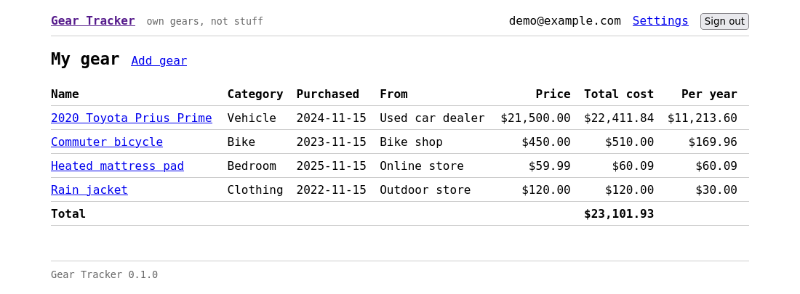
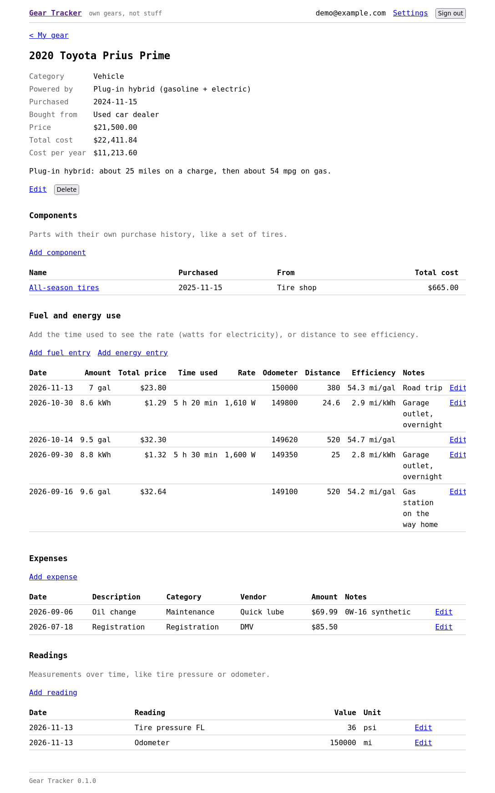
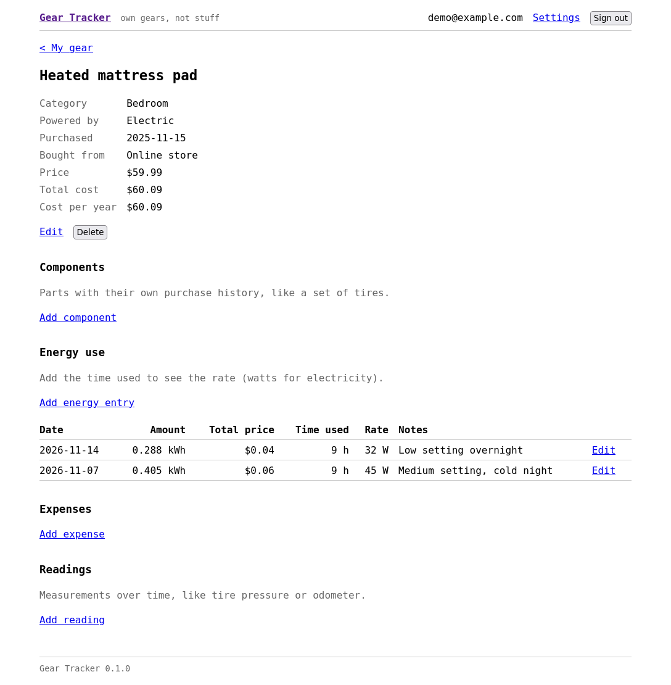
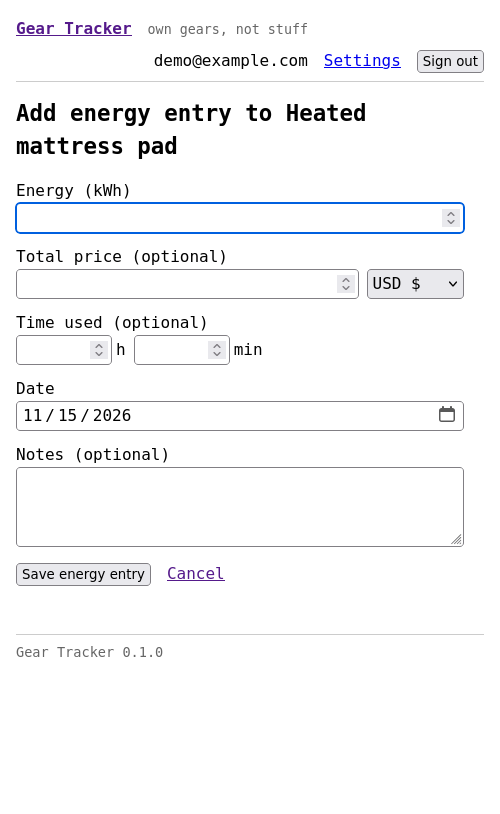

# Features

What Gear Tracker records, and what it works out from it.

- **Gear**: anything you own, with its purchase date, price, and where you bought it.
  Vehicles can also note their year, make, model and trim, and a nickname.
- **Components**: gear that belongs to other gear, like a set of tires on a car.
  Their costs count toward the parent's total.
- **Expenses**: money spent after the purchase, like repairs or insurance. Expenses of
  vehicles and their parts can note the odometer.
- **Power source**: what makes the gear go: nothing, human power, gasoline, diesel,
  propane, electricity, or both gasoline and electricity for a plug-in hybrid.
- **Fuel entries**: fill-ups (gallons) or energy use (kWh) for gear that runs on fuel or
  electricity. Add the time used to see fuel per hour or average watts, or the
  odometer or miles driven to see miles per gallon or per kWh, from one full tank to
  the next.
- **Vehicle stats**: running costs in total, per year, per mile or km and by category, and
  average, best, worst and latest efficiency. Running costs are what a vehicle costs
  to keep going after you buy it: fuel and charging, expenses like repairs and
  insurance, and the price of parts added as components. The purchase price isn't
  included.
- **Readings**: measurements over time, like tire pressure or tread depth. Readings of
  vehicles and their parts can also note the odometer.
- **API for agents**: let an agent or script read your gear and log expenses, fuel and
  energy use, and readings, with a token you create in Settings. See
  [the API docs](api.md), also served at `/api/v1`. To log fuel in a few taps
  without an agent, see [Log fuel from an iPhone Shortcut](iphone-shortcut.md).
- **Settings**: your currency, miles or kilometers, and US gallons, UK gallons or
  liters. Fuel entries are stored in kilometers and liters and shown in your units, so
  changing units updates old entries too. Your currency is the default for new prices and
  expenses; each one can be set to its own currency on its form. Totals in more than
  one currency show each separately.
- **Public profile**: optional. Pick a display name and username, turn your profile on,
  and choose which gear to show at `/u/<username>`, with or without its costs.
- **Vehicles page**: optional. List a vehicle at `/vehicles` to help people choosing a car,
  with or without its price, running costs and efficiency, and without your name unless
  you choose to show it.
- **Your data**: download everything as a JSON file, import that file into a new
  account, or delete your account, all from Settings.

## Screenshots

From version 0.1.0, with the demo's sample gear.

**Your gear**, with what each has really cost, in total and per year:

**A plug-in hybrid** (2020 Toyota Prius Prime at 150,000 miles) logging both gas
fill-ups and charging, with miles per gallon and miles per kWh:

**An appliance's energy use**: a heated mattress pad that averaged 32 W over a
9-hour night:

**On a phone**, adding an energy entry with time used in hours and minutes:

