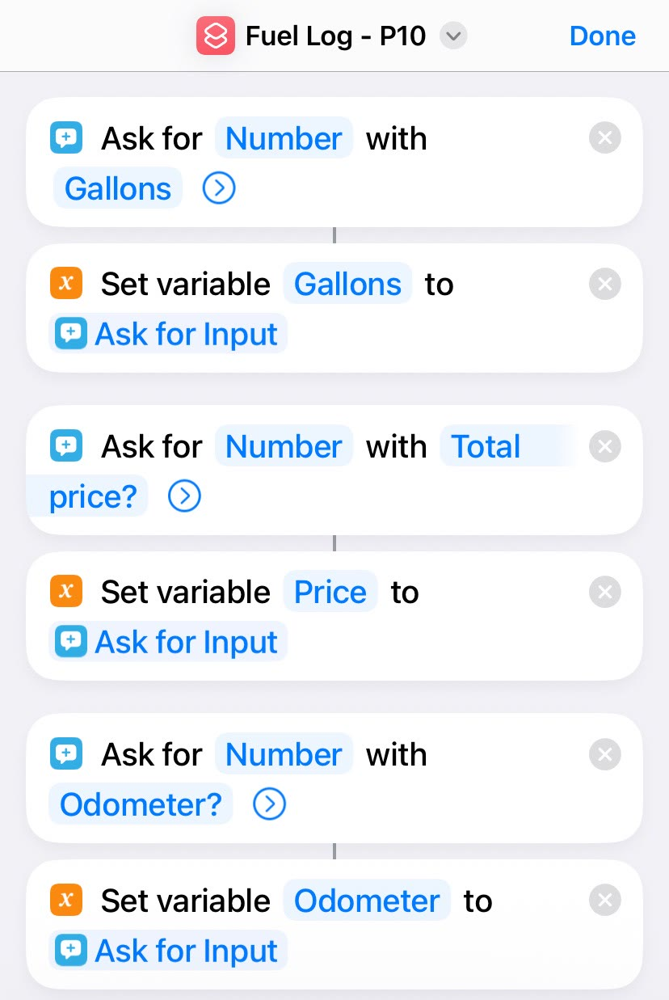
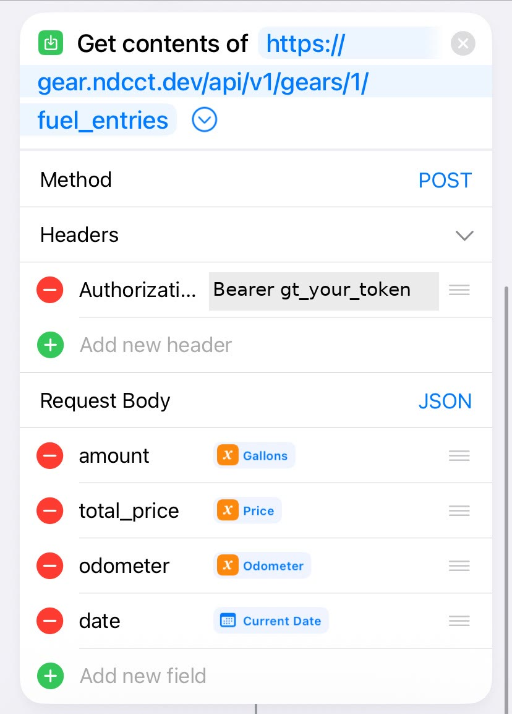
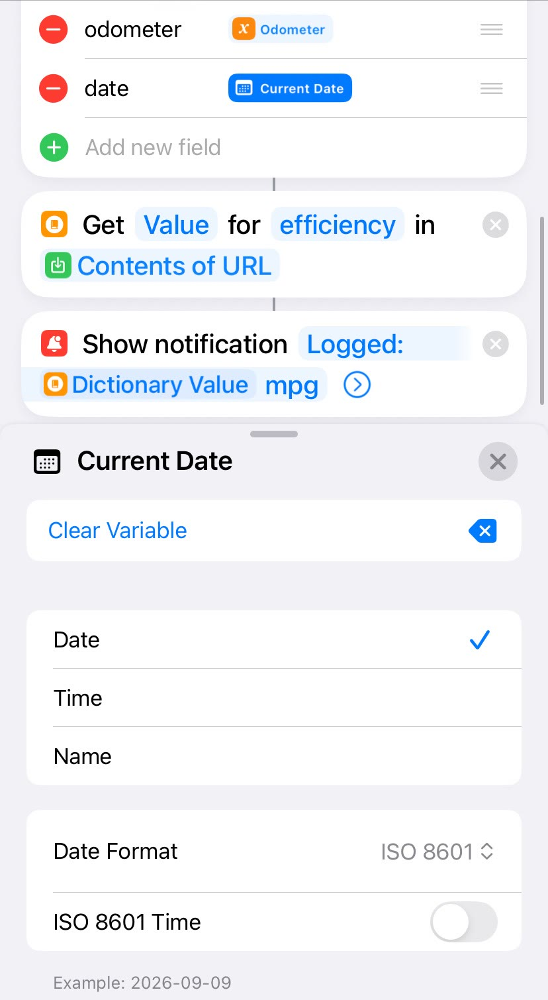

# Log fuel from an iPhone Shortcut

To log fuel in a few taps, with no agent or computer running, make a Shortcut
in the Shortcuts app for each vehicle. The gear's id is the number in its
page's address, like `/gears/12`. You'll need a **Read and write** token from
**Settings → API tokens**; the [API docs](api.md) list every field you can send.

1. **Ask for Input** (Number, decimals allowed) "Gallons?", then **Set
   Variable** `Gallons`. Do the same for `Price` and `Odometer`.

   

2. **Get Contents of URL** `https://your-server/api/v1/gears/12/fuel_entries`,
   with Method `POST` and one header: key `Authorization`, text
   `Bearer gt_your_token`. Set Request Body to JSON, with Number fields
   `amount` (Gallons), `total_price` (Price) and `odometer` (Odometer).

   

3. Optionally, a Text field `date` with the **Current Date** variable. Tap its
   chip and set Date Format to ISO 8601, with ISO 8601 Time off. Without it,
   the date is today in the time zone in your Settings; with it, it's the
   phone's date, which follows the phone when you travel.
4. **Get Dictionary Value** for key `efficiency` in Contents of URL, then
   **Show Notification** "Logged: Dictionary Value mpg".

   

Tips:

- While testing, show the whole Contents of URL instead: an `error` there says
  what went wrong.
- Remove any empty header row. A header with no name makes the request fail
  with "The network connection was lost".
- If a variable comes through empty, delete its blue chip and pick it again.
  A chip stays tied to the action it came from, even after that action is
  deleted.
- To log on cellular, turn on Shortcuts in iPhone **Settings → Cellular**.
- The token is saved inside the Shortcut, so don't share the Shortcut. If the
  phone is lost, revoke the token in Settings.
